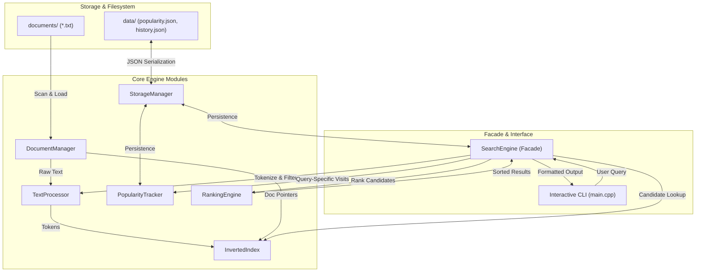

# Mini Search Engine — Architectural Specification & Design

## 1. Architectural Overview

The **Mini Search Engine** is a high-performance, modular desktop information retrieval system engineered in modern **C++ (C++17)**. It is structured around an inverted index data structure, statistical TF-IDF relevance scoring, query-specific document popularity tracking, and atomic JSON persistence.

The system enforces separation of concerns through an object-oriented design dividing responsibilities into distinct functional components:

---

## 2. Component Breakdown & Responsibilities

### 2.1 `Document` (`include/Document.h`, `src/Document.cpp`)
- **Role**: Domain model representing an individual text file.
- **Attributes**:
  - `uint32_t id_`: Monotonically allocated internal Document ID (DocID).
  - `std::string filename_`: Relative filename (e.g., `algorithms.txt`).
  - `std::string filepath_`: Canonical or relative path on disk.
  - `std::string rawContent_`: Unaltered document text, preserved for excerpt generation and reading.
  - `size_t wordCount_`: Total raw word count (whitespace-delimited) for accurate TF normalization.
  - `size_t fileSize_`: Size of file in bytes.
  - `std::filesystem::file_time_type lastModified_`: Timestamp for incremental change detection.
- **Key Methods**:
  - `getSnippet(const std::vector<std::string>& queryTerms, size_t maxChars)`: Locates earliest occurring query term and extracts a word-boundary-aligned context snippet with ellipses.

### 2.2 `DocumentManager` (`include/DocumentManager.h`, `src/DocumentManager.cpp`)
- **Role**: Filesystem abstraction and document collection repository.
- **Attributes**:
  - `std::unordered_map<uint32_t, Document> documents_`: Main document store indexed by DocID.
  - `std::unordered_map<std::string, uint32_t> pathToDocId_`: Deduplication table by canonical path.
  - `std::unordered_map<std::string, uint32_t> filenameToDocId_`: Fast resolution by basename.
  - `uint32_t nextDocId_`: Monotonic counter starting at 1.
- **Responsibilities**:
  - Auto-discovering `.txt` files in a designated directory.
  - Rejecting duplicate file ingestion.
  - Gracefully handling unreadable or empty files.
  - Detecting external file updates via `std::filesystem::last_write_time` and dynamically reloading contents.

### 2.3 `TextProcessor` (`include/TextProcessor.h`, `src/TextProcessor.cpp`)
- **Role**: Lexical analysis, text normalization, and query canonicalization.
- **Responsibilities**:
  - Case folding: Converts ASCII characters to lowercase.
  - Punctuation removal: Replaces punctuation characters with whitespace, with contextual exceptions (e.g., preserving `+` for `c++`).
  - Tokenization: Extracts non-empty tokens.
  - Configurable Stop-Word Filtering: Utilizes an internal `std::unordered_set<std::string>` containing 60+ common English function words.
  - Query Canonicalization: Generates a sorted, deduplicated token sequence (e.g., `"learning machine"` for `"machine learning"`), ensuring multi-keyword queries map to the same popularity key.

### 2.4 `InvertedIndex` (`include/InvertedIndex.h`, `src/InvertedIndex.cpp`)
- **Role**: Fast in-memory term dictionary and postings list store.
- **Data Structures**:
  - `struct Posting { uint32_t docId; uint32_t termFrequency; }`
  - `std::unordered_map<std::string, std::vector<Posting>> index_`: Vocabulary mapping to postings.
  - Postings lists are maintained in ascending order of `docId` for fast linear-time set intersection and union.
- **Responsibilities**:
  - Building index across all documents.
  - Resolving term frequency (TF) and document frequency (DF).
  - Resolving candidate document sets under conjunctive (`AND`) and disjunctive (`OR`) logic.
  - Dynamic addition and removal of documents.

### 2.5 `RankingEngine` (`include/RankingEngine.h`, `src/RankingEngine.cpp`)
- **Role**: Statistical scoring and document prioritization.
- **Scoring Formulas**:
  $$\text{TF}(t, d) = \frac{\text{freq}(t, d)}{\max(\text{wordCount}(d), 1)}$$
  $$\text{IDF}(t) = \ln\left(1.0 + \frac{N}{\max(\text{DF}(t), 1)}\right)$$
  $$\text{RawRelevance}(Q, d) = \sum_{t \in Q} \text{TF}(t, d) \times \text{IDF}(t)$$
  $$\text{NormRelevance}(d) = \frac{\text{RawRelevance}(d)}{\max_{d'} \text{RawRelevance}(d')}$$
  $$\text{NormPopularity}(Q, d) = \frac{\text{Visits}(Q, d)}{\max(\max_{d'} \text{Visits}(Q, d'), 1)}$$
  $$\text{FinalScore}(Q, d) = (\alpha \times \text{NormRelevance}(d)) + (\beta \times \text{NormPopularity}(Q, d))$$
  - Configurable weights default to $\alpha = 0.8$, $\beta = 0.2$.

### 2.6 `PopularityTracker` (`include/PopularityTracker.h`, `src/PopularityTracker.cpp`)
- **Role**: Query-specific document interaction tracker.
- **Data Structures**:
  - `std::unordered_map<std::string, std::unordered_map<uint32_t, uint32_t>> queryDocVisits_`:
    `canonicalQueryKey -> (docId -> visitCount)`.
  - `std::unordered_map<uint32_t, uint32_t> globalDocVisits_`: Aggregate document visits.
- **Design Rule**: Ensures total isolation between queries: opening a document for query `"python"` does not increase its visit count for query `"algorithms"`.

### 2.7 `StorageManager` (`include/StorageManager.h`, `src/StorageManager.cpp`)
- **Role**: Persistent JSON serialization and deserialization.
- **Responsibilities**:
  - Serialization: Serializes popularity data using document filenames (not ephemeral integer DocIDs), guaranteeing persistence safety across file additions, deletions, or restarts.
  - Atomic File Replacement: Writes to `.tmp` file and executes atomic rename (`std::filesystem::rename`) to prevent file corruption during sudden shutdown.
  - Corruption Recovery: Safely detects malformed JSON, backs up corrupted files as `.corrupted.<timestamp>`, and initializes a clean state without crashing.

### 2.8 `SearchEngine` (`include/SearchEngine.h`, `src/SearchEngine.cpp`)
- **Role**: High-level Facade uniting all subsystems into a cohesive API.
- **Methods**:
  - `initialize(docDir, dataDir)`
  - `search(query, mode)`
  - `openDocument(query, docId)`
  - `rebuildIndex()`
  - `saveState()`, `loadState()`

### 2.9 Console UI (`src/main.cpp`)
- **Role**: User-facing interactive terminal loop with input validation, table rendering, document view, and configuration menus.

---

## 3. Object-Oriented Principles Applied

| Principle | Implementation Details |
|---|---|
| **Encapsulation** | All internal structures (`index_`, `documents_`, `queryDocVisits_`) are private; mutation is strictly mediated by validated public member functions. |
| **Abstraction** | Subsystems expose high-level interfaces (e.g., `SearchEngine::search`) hiding complex inner workings (tokenization, postings traversal, TF-IDF calculation). |
| **Separation of Concerns** | Text processing does not perform I/O; Inverted index does not calculate ranking scores; Storage manager does not evaluate queries. |
| **Const Correctness** | All non-mutating accessors and helpers are marked `const noexcept` or `const`. |
| **RAII** | All file streams and resources are bound to local variable lifetimes, eliminating resource leaks. |
| **Zero-Copy References** | Documents and postings are passed via `const&` or `const*` rather than deep-copied. |
